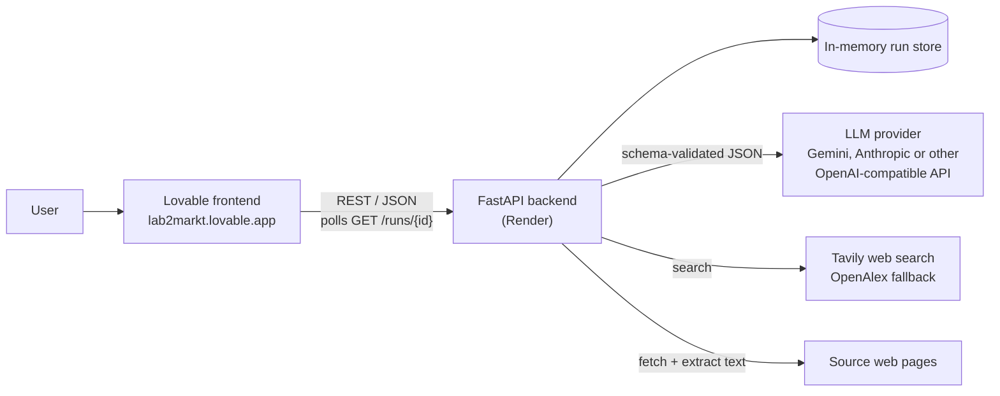

# Lab2Markt AI (backend)

A FastAPI service that turns a technical idea into a market assessment in which every number is labelled Fact, Estimate or Assumption. It then proposes experiments to test the weakest assumptions and updates its Continue / Pivot / Kill verdict as results come in.

**People's Choice Award, NiT Sparkathon 2026 (TUHH)**

**Frontend:** [thetnaisoe/Lab2Markt-Lovable](https://github.com/thetnaisoe/Lab2Markt-Lovable) · live app: <https://lab2markt.lovable.app/>

## Repositories

| Repository | Contents |
|---|---|
| This repo | Backend: API, assessment pipeline, market model, learning loop, evals |
| [Lab2Markt-Lovable](https://github.com/thetnaisoe/Lab2Markt-Lovable) | Frontend, built with Lovable (TypeScript) |

The frontend calls this API over HTTPS with JSON. Its TypeScript types are generated from this repo's Pydantic models by `scripts/export_contract.py` into `lovable/src/lib/`, and that folder is copied into the frontend repo. The API is deployed at `https://lab2market-api.onrender.com`. It runs on Render's free tier, so the first request after a pause can take about a minute.

## Problem and approach

The prototype answers Topic 8, "From Lab to Market". Many technical inventions never become products because their creators lack the time or support to assess the commercial opportunity. Confident but unsupported market figures make early decisions worse. Lab2Markt aims to help researchers and university transfer offices judge whether a lab result has a market, and what to test first.

The approach keeps evidence and guesswork apart:

- An LLM drafts the assessment and proposes experiments. Code verifies every quoted source, does all the arithmetic and decides the verdict.
- The pass and fail rules for each experiment are fixed and locked before any result is entered.
- When results arrive, the belief is updated with a Bayesian rule, the market model is re-run and the verdict follows the locked rules.

Planned next: pilots with university transfer offices, starting at TUHH.

## Architecture



A run moves through a fixed pipeline. Long steps run on a background thread, and the frontend polls the run state.

| Step | Done by | What happens |
|---|---|---|
| 1. Scope | LLM, 1 call | Accept the idea, ask clarifying questions, or refuse it (harmful, dual-use or physically infeasible). If accepted, draft low / likely / high ranges for five revenue drivers. |
| 2. Gate 1 | Human | Confirm or edit the interpretation and the ranges. |
| 3. Research | LLM + code | Search, fetch pages, rank passages with BM25. The LLM copies an exact quote with a number; code checks that the quote appears on the fetched page, grades the source and converts it into a driver estimate. |
| 4. Model | Code | Fits a Beta distribution to each share and a split lognormal to counts and prices, then runs a 5,000-draw Monte Carlo (fixed seed). Outputs a revenue range, a tornado chart and the probability of reaching a revenue threshold. |
| 5. Experiments | LLM, 1 call + code | Draft "k of n" experiments for the three weakest share assumptions. Code clamps each rule to valid values and writes the rule text; a fixed template is used if the call fails. |
| 6. Gate 2 | Human | Approve experiments and the threshold. Rules are locked with a timestamp. |
| 7. Results | Code | A Beta-Binomial update, re-run of the model, verdict from the locked rules, and re-ranking of open experiments by the chance that they flip the verdict per day of effort. |

LLM calls go through one client (`app/llm.py`):

- Every reply must match a Pydantic schema; a reply that fails is retried once.
- Calls are capped at 40 per run, and each call is logged.
- Idea text and fetched pages are passed inside delimiters as data, never as instructions.

## Features

- REST API: `GET /health`, `POST /runs`, `GET /runs/{id}`, `POST /runs/{id}/approve`, `POST /runs/{id}/results`, `POST /demo/reset`, `GET /evals/latest`. Interactive docs are served at `/docs`.
- Scope check with clarifying questions and refusal of harmful, dual-use or physically infeasible ideas. Input in German is answered in English.
- Claim ledger: each figure is a Fact (quote verified on a fetched page), an Estimate (computed by code, formula shown) or an Assumption. Each claim has an evidence weight based on its source type.
- An evidence floor: the headline figure is withheld when the most influential drivers lack verified facts.
- A market figure supplied by the user is kept as a claim and checked against the model, never treated as a fact.
- Probabilistic revenue model with sensitivity (tornado) analysis.
- Pre-registered k-of-n experiment rules, a Bayesian update from results, and a Continue / Pivot / Kill verdict decided by code.
- Experiment ranking by the probability of changing the verdict per day of effort.
- Provider-agnostic LLM layer: Anthropic, or any OpenAI-compatible API (Gemini, Mistral, Groq, OpenRouter, Azure OpenAI).
- Five demo runs loaded at start-up, so the frontend works without an LLM key.
- An evaluation script (`evals/run_evals.py`) with code-only property checks, LLM scenario cases and a single-prompt baseline. The last results are served at `/evals/latest`.
- pytest suite for the API, pipeline, providers and research steps.

## My role

The team had four members: two did market research and two did implementation. After the second implementer left, I built the rest of the backend and the frontend. The market researchers' guidance on how the AI should reason is reflected in the scoping and experiment prompts.

## Limitations and next steps

- **No database.** Runs live in process memory and are lost when the server restarts or the free Render instance sleeps. Persistence is the next step; `sql/schema.sql` is an earlier Supabase schema that the current code does not use.
- No user accounts or authentication. CORS allows all origins.
- The five revenue drivers are treated as independent. Only the three share drivers learn from experiment results; counts and prices change only through research.
- The source credibility tier is inferred from the web address.
- Experiment results are entered by users and not verified. Results in the demo runs are mocked and labelled as such.
- On free LLM tiers, rate limits can slow research or trigger the template fallback for experiments.

## Getting started

Requires Python 3.12 or newer.

```bash
git clone https://github.com/thetnaisoe/Lab2Markt-Sparkathon.git
cd Lab2Markt-Sparkathon/backend
python3 -m venv .venv
.venv/bin/pip install -r requirements-dev.txt
.venv/bin/python -m pytest -q
.venv/bin/uvicorn app.main:app --reload    # http://127.0.0.1:8000/docs
```

Without keys, the demo runs, the learning loop and the tests work. New runs stop at the AI step with a clear error. To enable the full pipeline, copy the template and fill it in:

```bash
cp ../.env.example .env    # loaded by app/env.py; never commit it
.venv/bin/python scripts/llm_smoke.py    # checks the LLM configuration
```

| Variable | Purpose |
|---|---|
| `LLM_PROVIDER` | `anthropic`, `openai`, or an OpenAI-compatible alias: `gemini`, `mistral`, `groq`, `openrouter`, `azure` |
| `LLM_API_KEY` | Key for that provider |
| `LLM_MODEL` | Model id (required for OpenAI-compatible providers) |
| `LLM_BASE_URL` | Optional; custom OpenAI-compatible endpoint (required for `azure`) |
| `LLM_MAX_CALLS_PER_RUN` | Optional; LLM call cap per run (default 40) |
| `LLM_MAX_RETRIES` | Optional; SDK retries on rate limits and server errors (default 2) |
| `RESEARCH_LLM_WORKERS` | Optional; parallel LLM calls during research (default 4; lower it on free tiers) |
| `TAVILY_API_KEY` | Optional; web search. Without it, research uses OpenAlex only. |

On Render, `render.yaml` defines the service (build and start commands, `/health` check). Set the same variables in the Render dashboard.

### Development

After changing `app/models.py` or a demo run, regenerate the derived files:

```bash
.venv/bin/python scripts/build_fixtures.py    # recompute demo runs with the current code
.venv/bin/python scripts/export_contract.py   # fixtures/schema.json and lovable/src/lib/*.ts
.venv/bin/python evals/run_evals.py --llm     # rewrites evals/results/latest.json; without --llm only code checks are kept
```

## Project layout

```
backend/app/main.py         FastAPI app and endpoints
backend/app/models.py       API contract (Pydantic), source of truth for the frontend types
backend/app/runner.py       run lifecycle and gates
backend/app/llm*.py         provider-agnostic structured LLM client
backend/app/pipeline/       scope, research, model, learning loop, experiments, report text
backend/evals/              evaluation cases, runner and latest results
backend/tests/              pytest suite
fixtures/                   demo runs and generated JSON schema
lovable/src/lib/            TypeScript contract (generated), API client and helpers copied into the frontend
```
